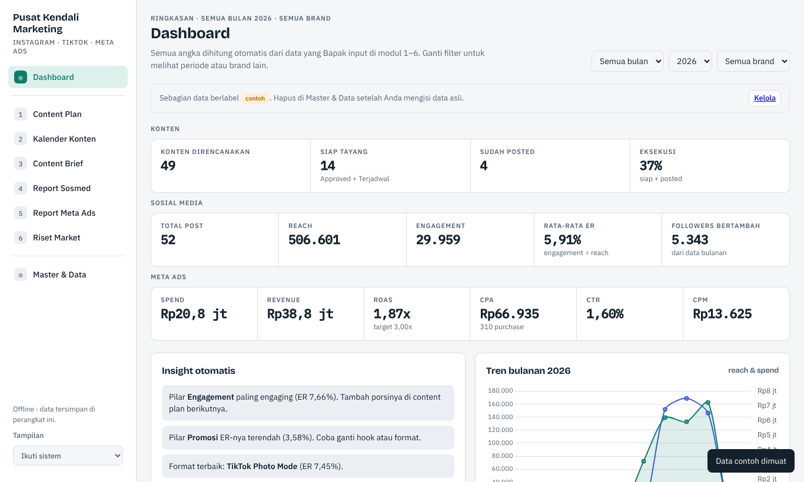
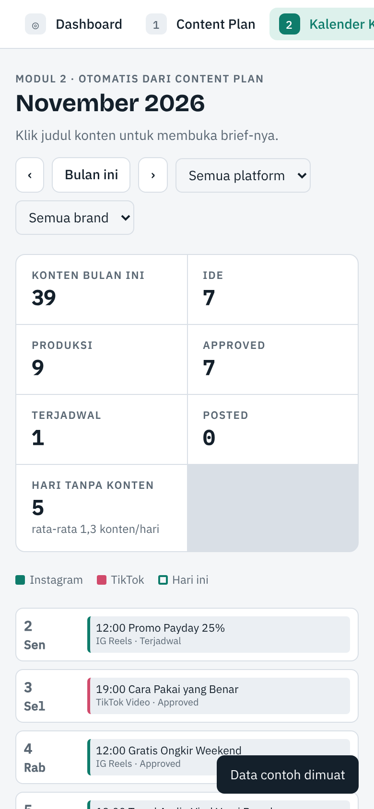

# Pusat Kendali Marketing

Aplikasi kerja digital marketing dalam satu tempat: **content plan, kalender konten, content brief, report sosial media, report Meta Ads, dan riset market**. Data cukup diisi sekali, lalu kalender, brief, grafik, segmentasi, dan insight muncul otomatis.

Bisa dipakai di **HP (Android & iPhone)** dan **laptop**, dan tetap jalan **tanpa internet**.





---

## Fitur

| Modul | Yang diisi | Yang keluar otomatis |
|---|---|---|
| **Dashboard** | – | KPI konten, sosmed & ads, tren bulanan, grafik, insight otomatis |
| **1. Content Plan** | Tanggal, brand, platform, format, pilar, funnel, judul, hook, caption, CTA, PIC, status | Kode konten, hari, grafik pilar/status/funnel/format/PIC/hari |
| **2. Kalender Konten** | – | Kalender bulanan + ringkasan status (dari Content Plan) |
| **3. Content Brief** | Strategi, KPI target, scene breakdown | Info konten otomatis, salin/bagikan/unduh teks brief |
| **4. Report Sosmed** | Reach, views, likes, comments, shares, saves, dll. per postingan | Engagement, ER, save/share rate, label performa, top 5, grafik |
| **5. Report Meta Ads** | Spend, impressions, clicks, hasil, purchases, revenue | CPM, CTR, CPC, cost/hasil, CVR, CPA, ROAS, rekomendasi Scale Up/Optimasi/Stop, segmentasi usia/gender/placement |
| **6. Riset Market** | Kompetitor, segmen pasar, data survei, SWOT | ER & share of voice kompetitor, skor STP, profil & segmentasi silang responden, insight |
| **Master & Data** | Daftar pilihan, benchmark ER, target KPI | Backup/pulihkan data, data contoh, tema terang/gelap |

---

## Cara memakai

Ada tiga cara. Ketiganya memakai aplikasi yang sama.

### A. Lewat link (paling mudah, bisa di-instal di HP & laptop)

Setelah GitHub Pages aktif (lihat bagian *Menaruh di GitHub*), aplikasi bisa dibuka di:

```
https://USERNAME-GITHUB-ANDA.github.io/pusat-kendali-marketing/
```

- **HP Android (Chrome):** buka link → menu ⋮ → **Instal aplikasi** / **Tambahkan ke layar utama**.
- **iPhone (Safari):** buka link → tombol Bagikan → **Tambahkan ke Layar Utama**.
- **Laptop (Chrome/Edge):** buka link → klik ikon **Instal** di ujung kanan kolom alamat.

Setelah dibuka sekali, aplikasi tetap bisa dipakai tanpa internet.

### B. APK Android

Unduh `PusatKendaliMarketing.apk` dari halaman **Releases** (atau dari tab **Actions** → build terakhir → *Artifacts*), lalu buka file-nya di HP. Izinkan pemasangan dari sumber tidak dikenal bila diminta.

### C. File di laptop

Unduh `index.html`, simpan di satu folder tetap, lalu buka dengan Chrome/Edge.

---

## Data & privasi

- Semua data tersimpan **di perangkat masing-masing** (penyimpanan browser/aplikasi). **Tidak ada data yang dikirim ke GitHub** atau server mana pun.
- Data di HP, laptop, dan versi link **tidak tersinkron otomatis**. Untuk memindahkan data: **Master & Data → Buat backup (.json)** di perangkat lama, kirim file-nya, lalu **Pulihkan dari backup** di perangkat baru.
- Buat backup rutin (misalnya seminggu sekali). Menghapus aplikasi atau data browser juga menghapus data di perangkat itu.

---

## Menaruh di GitHub (tanpa perlu paham Git)

### 1. Buat repository

1. Masuk ke [github.com](https://github.com) → tombol **New** (repository baru).
2. Nama: `pusat-kendali-marketing`. Pilih **Public** (GitHub Pages gratis hanya untuk repository publik; kodenya terlihat publik, tapi **data Anda tidak**, karena data ada di perangkat).
3. Klik **Create repository**.

### 2. Unggah file

1. Ekstrak file ZIP repository ini di komputer.
2. Di halaman repository, klik **uploading an existing file**.
3. Seret **semua isi folder** (termasuk folder `.github`, `android`, `docs`, `icons`, `scripts`) ke halaman tersebut, lalu **Commit changes**.

> Folder `.github` kadang tersembunyi. Di Windows: File Explorer → *View* → centang *Hidden items*. Di Mac: tekan `Cmd + Shift + .` di Finder.
> Alternatif yang lebih mudah untuk banyak file: [GitHub Desktop](https://desktop.github.com).

### 3. Aktifkan GitHub Pages (link aplikasi)

**Settings → Pages → Build and deployment → Source: Deploy from a branch → Branch: `main` / `(root)` → Save.**
Tunggu 1–2 menit, link aplikasi muncul di halaman yang sama.

### 4. Aktifkan build APK otomatis (opsional, disarankan)

Setiap kali `index.html` atau folder `android/` diubah, GitHub Actions membangun APK baru secara otomatis.

Agar APK baru bisa **meng-update** aplikasi yang sudah terpasang (tanpa kehilangan data), APK harus ditandatangani dengan **keystore yang sama**. Simpan keystore sebagai *Secrets*:

**Settings → Secrets and variables → Actions → New repository secret**, buat tiga secret:

| Nama secret | Isi |
|---|---|
| `KEYSTORE_BASE64` | Teks base64 dari file keystore (ada di file catatan keystore yang diberikan terpisah) |
| `KEYSTORE_PASSWORD` | Password keystore |
| `KEY_ALIAS` | `pusatkendali` |

Tanpa secret ini, build tetap berjalan tetapi memakai keystore sementara, sehingga APK-nya **tidak bisa** meng-update aplikasi lama (harus uninstall dulu, data ikut hilang kecuali sudah di-backup).

### 5. Mengambil APK

- **Build biasa:** tab **Actions** → *Build APK* → pilih build terakhir → unduh di bagian **Artifacts** (berbentuk ZIP, isinya APK).
- **Rilis resmi:** tab **Releases** → **Draft a new release** → *Choose a tag* → ketik versi baru, misalnya `v1.0.1` → **Publish release**. Beberapa menit kemudian APK otomatis ditempel ke release tersebut.
- Build juga bisa dijalankan manual: **Actions → Build APK → Run workflow**.

---

## Memperbarui aplikasi

1. Ganti `index.html` dengan versi baru (lewat tombol **Add file → Upload files**, atau edit langsung di GitHub).
2. Versi link otomatis memakai `index.html` terbaru saat online. Bila ikon atau file lain ikut berubah, naikkan juga angka versi di `sw.js` (`pusat-kendali-v1` → `pusat-kendali-v2`).
3. APK baru dibangun otomatis oleh GitHub Actions. Buat release baru (misalnya `v1.0.2`) untuk menerbitkannya.

---

## Struktur folder

```
├── index.html                  # Aplikasi lengkap (satu file, bisa offline)
├── manifest.webmanifest        # Agar bisa di-instal sebagai aplikasi (PWA)
├── sw.js                       # Service worker untuk mode offline
├── icons/                      # Ikon aplikasi
├── docs/                       # Gambar untuk README
├── android/                    # Proyek Android (WebView) untuk APK
│   ├── AndroidManifest.xml
│   ├── res/                    # Ikon & nama aplikasi
│   └── src/.../MainActivity.java
├── scripts/build-apk.sh        # Script build APK
└── .github/workflows/build-apk.yml   # Build APK otomatis di GitHub
```

## Build APK di komputer sendiri (opsional)

Di Ubuntu/Debian (atau WSL di Windows):

```bash
sudo apt-get install -y aapt apksigner zipalign android-sdk-platform-23 dalvik-exchange default-jdk
KEYSTORE_FILE=/lokasi/release.keystore KEYSTORE_PASSWORD='password-anda' VERSION_CODE=3 VERSION_NAME=1.0.2 \
  bash scripts/build-apk.sh
# hasil: build/PusatKendaliMarketing.apk
```

## Keystore: penting

- **Jangan pernah mengunggah file keystore atau password-nya ke repository.** File `.gitignore` sudah mencegah file `*.keystore` ikut terunggah.
- Simpan keystore dan password-nya di tempat aman (misalnya Google Drive pribadi + pengelola password).
- Jika keystore hilang, APK baru tidak bisa meng-update aplikasi lama.

---

© 2026. Hak cipta dilindungi.
